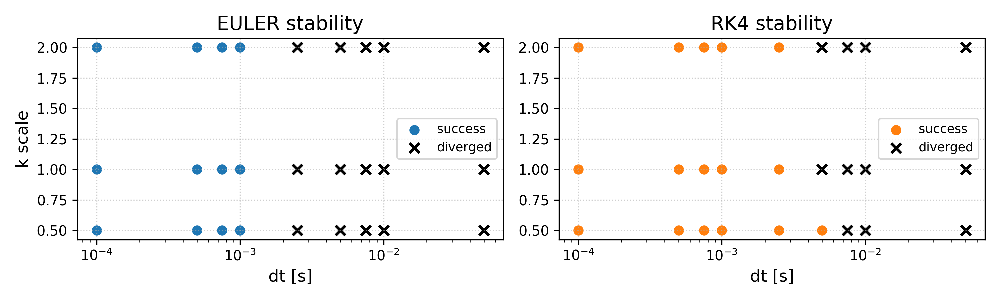
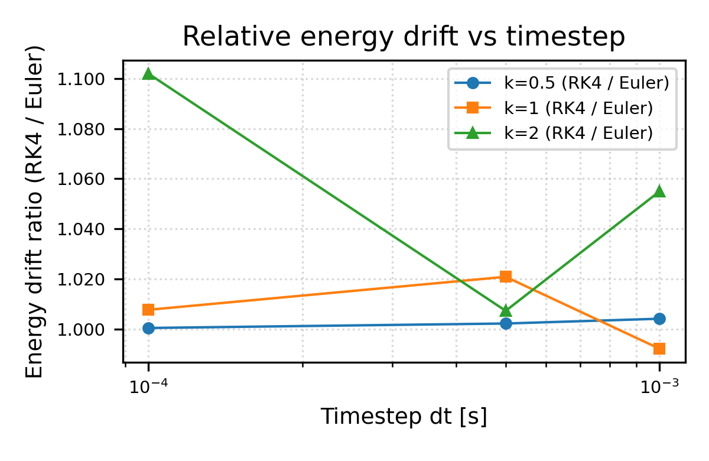

# Cloth Simulation

A mass-spring cloth simulation of a flag in the wind, written from scratch in NumPy and rendered in Blender. The project compares explicit Euler and fourth-order Runge-Kutta (RK4) integration and maps where each one stays stable as the timestep and spring stiffness change.

  

## How it works

- **Cloth model.** A grid of point masses (20 × 15 by default) connected by structural, shear and bending springs, with gravity and a laminar wind force. The two corners on the pole side are fixed, like a flag on a pole.
- **Integrators.** Explicit Euler and RK4 behind a common `step()` interface, so every scenario can be run with either.
- **Experiments.** A parameter sweep over integrator, timestep (10⁻⁴ to 5 × 10⁻² s) and stiffness scale (0.5, 1, 2), run in parallel. Each run records energy, spring stretch and runtime.
- **Rendering.** Simulation states are exported to `.npz` and replayed in Blender, which builds the cloth mesh and renders the sequence to frames and a GIF.

## Results

  

- **Stability.** Euler stays stable up to a timestep of 10⁻³ s at every stiffness tested. RK4 stays stable up to 2.5 × 10⁻³ s, and up to 5 × 10⁻³ s for the softest cloth. That is a 2.5× to 5× larger timestep.
- **Accuracy.** Where both integrators are stable, RK4 does not reduce energy drift. The ratio of RK4 to Euler drift stays between about 0.99 and 1.10. RK4's benefit here is the larger stable timestep, which has to be weighed against its four force evaluations per step.

  

## Get started

Installation, running scenarios, the parameter sweep and Blender rendering are described in [SETUP.md](SETUP.md).

Built with Python, NumPy, Matplotlib and Blender.
